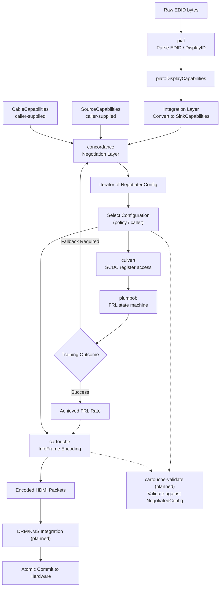

# The stack

```text
Integration layer      compositor glue · DRM/KMS · source capability query   (planned)
Driver-adjacent layer  FRL link training                                     plumbob · plumbob-async
Protocol layer         CEC · eARC                                            (planned)
Signaling layer        InfoFrames · SCDC                                     cartouche · culvert · culvert-async
Negotiation layer      enumeration · validation · ranking                    concordance
Parsing layer          EDID · DisplayID                                      piaf
Shared types           display vocabulary                                    display-types
Hardware abstraction   SCDC transport · PHY                                  hdmi-hal · hdmi-hal-async · hdmi-hal-i2c-dev
```

## From bytes to a trained link

The critical path — what a minimal working HDMI 2.1 link needs, in order:

| Step | What happens                                                                                       | Crate                   | Status    |
|------|----------------------------------------------------------------------------------------------------|-------------------------|-----------|
| 1    | Parse the sink's EDID / DisplayID into typed capabilities                                          | piaf                    | Released  |
| 2    | Negotiate a ranked list of configurations the sink, source and cable can all carry                 | concordance             | Released  |
| 3    | Read and write the sink's SCDC registers                                                           | culvert                 | Released  |
| 4    | Train the FRL link, stepping down rates when the sink asks, falling back to TMDS                   | plumbob                 | Released  |
| 5    | Run the above against real hardware from Linux userspace                                           | hdmi-hal-i2c-dev        | Released  |
| 6    | Describe the chosen configuration in InfoFrames                                                    | cartouche               | Released  |
| 7    | Discover the source's capabilities from DRM/KMS                                                    | —                       | Planned   |
| 8    | Turn the negotiated configuration into a DRM atomic modeset                                        | —                       | Planned   |

CEC, eARC and further PHY configuration are off the critical path.

## Where policy lives

The parsing and protocol layers are judgment-free: they implement the specification and
report what they find. The negotiation layer is where opinions live — it ranks candidates
by a `NegotiationPolicy` you can override, and every accepted or rejected candidate carries
a reasoning trace explaining why.

## End-to-End Data Flow

